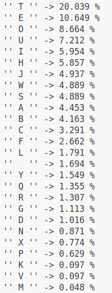
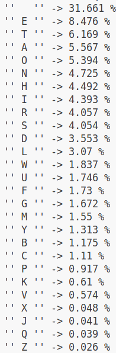
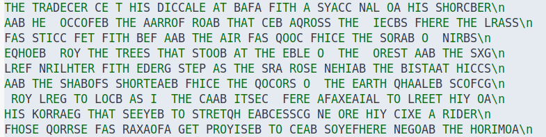

# 01 · Substitution Cipher Cryptanalysis

Recovering an English text encrypted with a **monoalphabetic substitution cipher**, without the key, using **frequency analysis** and word patterns.

📄 [Report (PDF)](report.pdf)

## Approach

1. **Structure first.** Every ciphertext line ended with `TT`, so `TT` was mapped to the newline.
2. **Frequency analysis.** The ciphertext letter frequencies were compared with English frequencies. The most frequent symbol, `T` at ~20%, is the space, and the next ones map to `E` and `T`.
3. **Word patterns.** Candidate substitutions were confirmed or rejected by the words they produce. For example, `TUE` forces `U = H` ("THE"), `THIT` forces `I = A` ("THAT"), and `EAJTH` forces `J = R` ("EARTH").
4. **Iterate** until every ciphertext symbol is mapped: 27 entries, including the space and the newline.

| Ciphertext frequencies | English frequencies (reference) |
|:---:|:---:|
|  |  |

Partial decryption during the attack, with the substituted characters in green:



## Recovered key

| Cipher | `TT` | `T` | `O` | `U` | `I` | `H` | `J` | `W` | `A` | `B` | `C` | `F` | `L` | `␣` | `Y` | `Q` | `R` | `G` | `D` | `N` | `X` | `K` | `V` | `M` | `E` `S` `P` |
|---|---|---|---|---|---|---|---|---|---|---|---|---|---|---|---|---|---|---|---|---|---|---|---|---|---|
| Plain | ↵ | space | T | H | A | O | R | I | N | D | L | W | G | F | M | C | U | Y | V | B | K | J | X | Z | unchanged |

## Run it

```bash
python3 substitution_tool.py            # decrypts ciphertext.txt with the recovered key
python3 substitution_tool.py --freq     # also prints the ciphertext letter frequencies
python3 substitution_tool.py --highlight
```

The output matches [`plaintext.txt`](plaintext.txt) exactly ("THE TRAVELER LEFT HIS VILLAGE AT DAWN…").

## Files

- `substitution_tool.py`: the three helper functions used during the attack (add a substitution, apply the substitutions, compute frequencies), plus a runner with the final key
- `ciphertext.txt` / `plaintext.txt`: the challenge and the recovered text
