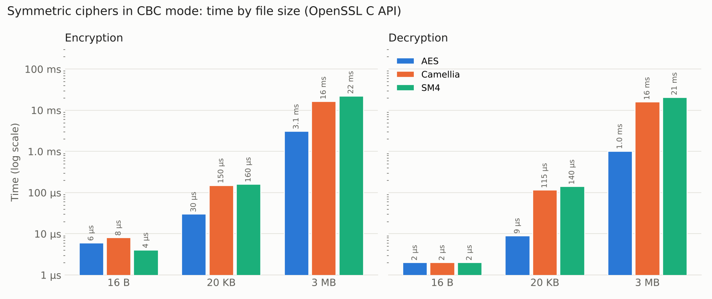

# 02 · OpenSSL CBC Cipher Benchmark

Comparing **AES, Camellia and SM4 in CBC mode** on files of 16 B, 20 KB and 3 MB, first from the OpenSSL command line and then with a C program using the **OpenSSL EVP API**.

📄 [Report (PDF)](report.pdf)



## Results (C program, average of several runs)

| File | Algorithm | Encryption | Decryption |
|---|---|---:|---:|
| 16 B | AES | 6 µs | 2 µs |
| 16 B | Camellia | 8 µs | 2 µs |
| 16 B | SM4 | 4 µs | 2 µs |
| 20 KB | AES | 30 µs | 9 µs |
| 20 KB | Camellia | 150 µs | 115 µs |
| 20 KB | SM4 | 160 µs | 140 µs |
| 3 MB | AES | **3.1 ms** | **1.0 ms** |
| 3 MB | Camellia | 16.4 ms | 15.9 ms |
| 3 MB | SM4 | 22.3 ms | 20.7 ms |

**Takeaways**

- **AES is the fastest as soon as there is real data to process:** on 3 MB it is 5–7× faster than Camellia and SM4 to encrypt, and 15–20× faster to decrypt. This is consistent with the hardware AES instructions (AES-NI) available on modern CPUs.
- **On 16-byte inputs the differences are only a few microseconds**, so they are dominated by fixed overhead and measurement noise.
- **Decryption is faster than encryption for AES.** CBC decryption can be parallelised, while CBC encryption is inherently sequential.

## Run it

```bash
dd if=/dev/urandom of=16byte.bin bs=16 count=1
dd if=/dev/urandom of=20KB.bin bs=1024 count=20
dd if=/dev/urandom of=3MB.bin bs=1M count=3

gcc cbc_benchmark.c -o cbc_benchmark -lcrypto
./cbc_benchmark
```

## Files

- `cbc_benchmark.c`: generates a random key and IV with `RAND_bytes`, then encrypts and decrypts every file with each cipher through `EVP_EncryptInit_ex` / `EVP_DecryptInit_ex` and times each operation
- `cli_examples.sh`: the same operations with the `openssl enc` command line
