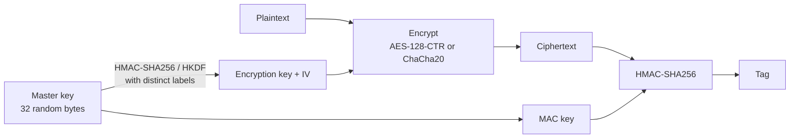
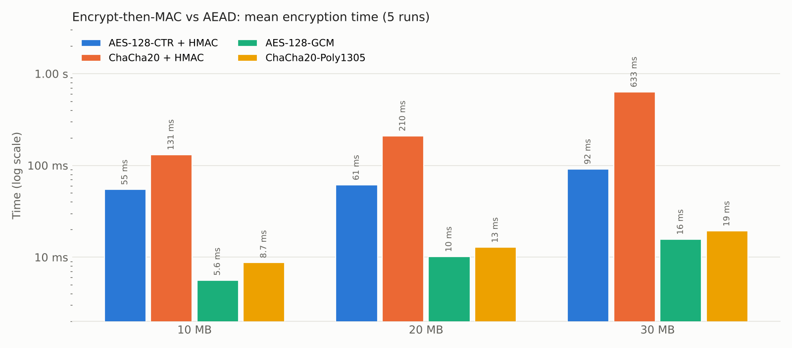

# 03 · Encrypt-then-MAC vs AEAD

Four ways to get **confidentiality + integrity** on 10, 20 and 30 MB files: two **Encrypt-then-MAC** constructions built by hand, and two **AEAD** ciphers. All keys are derived from a single 32-byte master key.

📄 [Report (PDF)](report.pdf)



| Construction | Type | Implementation | Key derivation |
|---|---|---|---|
| AES-128-CTR + HMAC-SHA256 | Encrypt-then-MAC | `openssl` CLI | HMAC-SHA256 with labels |
| ChaCha20 + HMAC-SHA256 | Encrypt-then-MAC | `openssl` CLI | HMAC-SHA256 with labels |
| AES-128-GCM | AEAD | C, OpenSSL EVP API | HKDF-SHA256 |
| ChaCha20-Poly1305 | AEAD | C, OpenSSL EVP API | HKDF-SHA256 |

## Results (mean of 5 runs)



| | 10 MB | 20 MB | 30 MB |
|---|---:|---:|---:|
| AES-128-GCM | **5.6 ms** | **10.2 ms** | **15.7 ms** |
| ChaCha20-Poly1305 | 8.7 ms | 12.8 ms | 19.3 ms |
| AES-128-CTR + HMAC | 54.6 ms | 61.4 ms | 91.6 ms |
| ChaCha20 + HMAC | 131 ms | 210 ms | 633 ms |

**Takeaways**

- **AEAD wins clearly.** It encrypts and authenticates in a single pass, and AES-GCM additionally benefits from hardware AES and carry-less multiplication instructions.
- **ChaCha20-Poly1305 is a close second.** It is a pure software design, which is why it is preferred on devices without AES hardware support.
- **Between the two Encrypt-then-MAC variants, AES-CTR is faster than ChaCha20.** ChaCha20 + HMAC also shows a large run-to-run variance (0.11–1.1 s at 30 MB).
- **Measurement note:** the Encrypt-then-MAC timings come from `time` on the CLI, so they include process start-up and file I/O. The AEAD timings measure in-memory encryption inside the C program. The gap is therefore partly due to the measurement method.

## Run it

```bash
./setup_keys_and_files.sh          # master.key, masterkey.hex, 10/20/30 MB test files
./etm_aes128ctr_hmac.sh
./etm_chacha20_hmac.sh

gcc -o aes128_gcm aes128_gcm.c -lssl -lcrypto && ./aes128_gcm
gcc -o chacha20_poly1305 chacha20_poly1305.c -lssl -lcrypto && ./chacha20_poly1305
```

The scripts need `openssl` and `xxd`.
