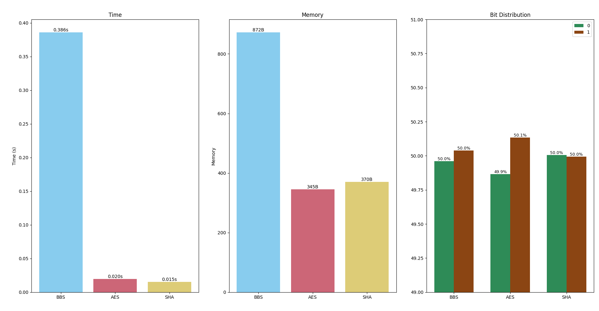

# 05 · CSPRNG / DRBG Comparison

Three cryptographically secure pseudo-random generators produce **100,000 bits from the same 32-byte seed**, and are compared on speed, memory and bit balance.

📄 [Report (PDF)](report.pdf)

| Generator | How it works | Security basis |
|---|---|---|
| **Blum Blum Shub** | x ← x² mod n with n = p·q (512-bit primes ≡ 3 mod 4); outputs the last bit of each state | Hardness of factoring n |
| **CTR_DRBG (AES)** | Key = SHA-256(seed); encrypts an increasing 128-bit counter with AES; 128 bits per step | Security of AES |
| **Hash_DRBG (SHA-256)** | SHA-256(seed ‖ counter); 256 bits per step | Security of SHA-256 |

## Results



| Generator | Time (100,000 bits) | Memory | 0s / 1s |
|---|---:|---:|---:|
| Blum Blum Shub | 0.386 s | 872 B | 50.0% / 50.0% |
| CTR_DRBG (AES) | 0.020 s | 345 B | 49.9% / 50.1% |
| Hash_DRBG (SHA-256) | **0.015 s** | 370 B | 50.0% / 50.0% |

**Takeaways**

- **Blum Blum Shub is ~20× slower.** It squares a 1024-bit number to produce a single bit. Its security comes from a hard mathematical problem, but this makes it impractical for bulk generation.
- **The two standard DRBGs are fast and balanced.** CTR_DRBG and Hash_DRBG produce 128 and 256 bits per step and rely on primitives optimised for modern hardware.
- **All three generators give a near-perfect 50/50 distribution of 0s and 1s.** A balanced output is a necessary first check, not a proof of randomness.

## Run it

```bash
pip install pycryptodome
python3 drbg_comparison.py
```

Prints the time, 0/1 balance and the first 50 bits of each generator. Timings depend on the machine.
