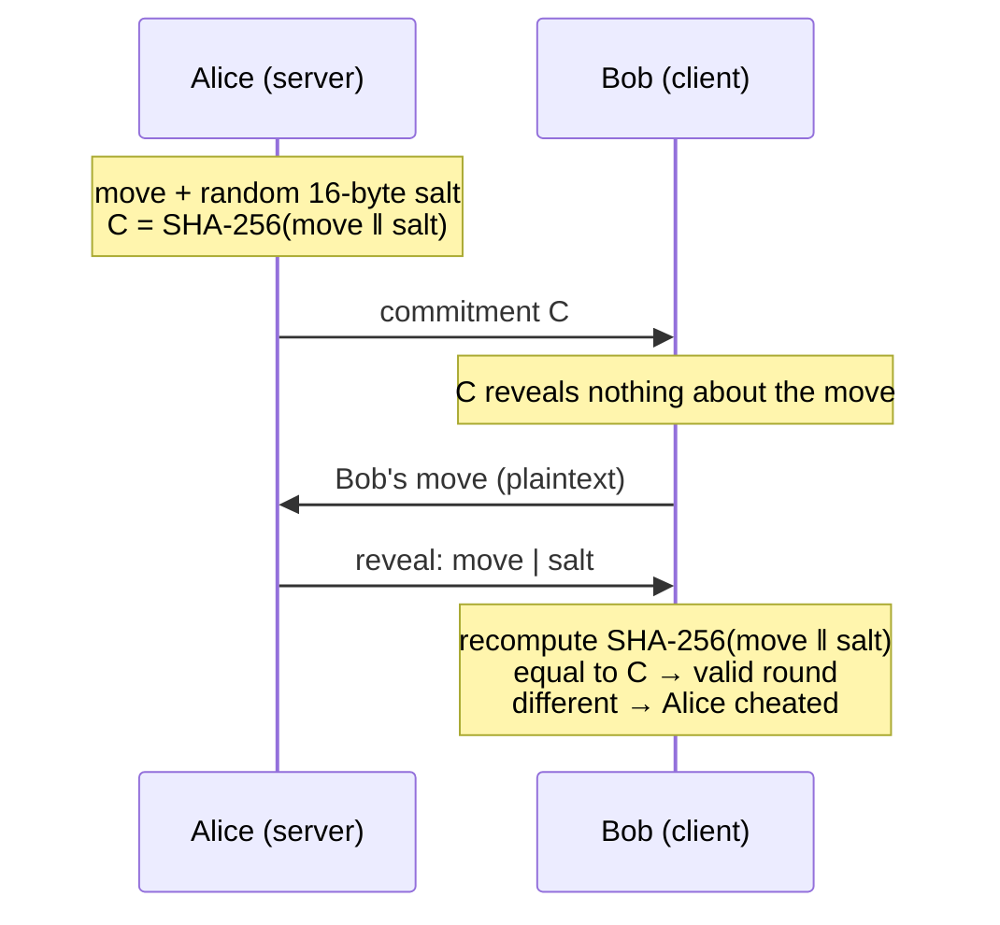
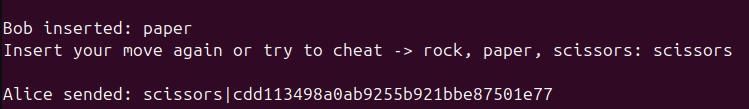
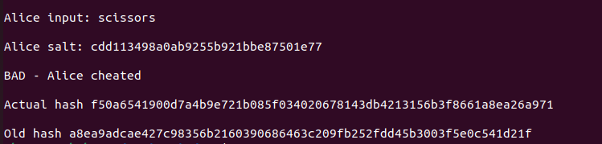
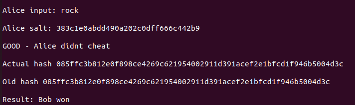

# 06 · Commit-Reveal Protocol over TCP

A **cheat-proof Rock Paper Scissors** game between two machines. A **SHA-256 commit-reveal protocol** makes sure that a player cannot change their move after seeing the opponent's.

📄 [Report (PDF)](report.pdf)

## Protocol



- **Hiding:** the random salt (`secrets.token_hex(16)`) prevents Bob from brute-forcing the three possible moves from the hash.
- **Binding:** Alice cannot find a different move that produces the same SHA-256 hash.

## Demo (two Linux VMs in bridged mode)

| Alice tries to cheat (rock → scissors) | Detected by Bob |
|:---:|:---:|
|  |  |

An honest round, where the two hashes match:



## Run it

On Alice's machine, which must start first:

```bash
python3 alice_server.py
```

On Bob's machine, after setting Alice's IP address in `bob_client.py` (`soc.connect(("192.168.1.7", 12345))`):

```bash
python3 bob_client.py
```

Both scripts use only the Python standard library (`socket`, `hashlib`, `secrets`). The messages travel over plain TCP: the protocol guarantees fairness between the two players, not the confidentiality of the channel.
