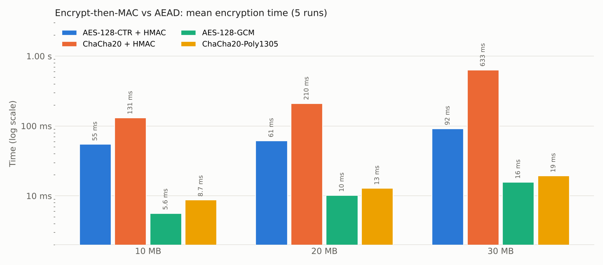

# Applied Cryptography Labs

**Six hands-on cryptography projects in C, Python and Bash**, from breaking a classical cipher by hand to benchmarking modern authenticated encryption with the OpenSSL C API and building a cheat-proof protocol between two machines.

> University coursework, Sapienza University of Rome (A.Y. 2025/2026). Each folder contains the code, the results and the original report (PDF).

<p align="center"></p>

## Projects

| # | Project | What it shows | Stack |
|---|---|---|---|
| 01 | [Substitution cipher cryptanalysis](01-substitution-cipher-cryptanalysis) | Broke a monoalphabetic cipher with frequency analysis and word patterns, using a small Python tool | Python |
| 02 | [OpenSSL CBC cipher benchmark](02-openssl-cbc-cipher-benchmark) | AES vs Camellia vs SM4 on 16 B – 3 MB files, CLI and **OpenSSL EVP C API** | C, OpenSSL, Bash |
| 03 | [Encrypt-then-MAC vs AEAD](03-encrypt-then-mac-vs-aead) | AES-CTR/ChaCha20 + HMAC versus AES-GCM and ChaCha20-Poly1305, with **HKDF** key derivation | C, OpenSSL, Bash |
| 04 | [age file-encryption guide](04-age-file-encryption-guide) | Passphrase (scrypt) and public-key (X25519) encryption with `age`, file format explained | Bash, age |
| 05 | [CSPRNG / DRBG comparison](05-csprng-drbg-comparison) | Blum Blum Shub vs CTR_DRBG (AES) vs Hash_DRBG (SHA-256): speed and bit balance | Python |
| 06 | [Commit-reveal protocol over TCP](06-commit-reveal-protocol-over-tcp) | Cheat-proof Rock Paper Scissors between two VMs with SHA-256 commitments | Python, sockets |

## Highlights

- **AEAD outperforms hand-built Encrypt-then-MAC.** AES-128-GCM encrypts 30 MB in ~16 ms and ChaCha20-Poly1305 in ~19 ms, against 92 ms for AES-CTR + HMAC ([03](03-encrypt-then-mac-vs-aead)).
- **AES dominates CBC throughput.** On 3 MB, AES encrypts in ~3 ms against 16 ms for Camellia and 22 ms for SM4, consistent with hardware AES acceleration ([02](02-openssl-cbc-cipher-benchmark)).
- **Security vs speed in random number generation.** Blum Blum Shub is ~20× slower than CTR_DRBG and Hash_DRBG, while all three produce a balanced 50/50 bit stream ([05](05-csprng-drbg-comparison)).
- **Cheating is detected.** If a player changes their move after seeing the opponent's, the SHA-256 commitment no longer matches ([06](06-commit-reveal-protocol-over-tcp)).
- **The classical cipher was fully recovered.** The recovered 27-symbol key turns the ciphertext back into the original English text ([01](01-substitution-cipher-cryptanalysis)).

## Skills

`Symmetric encryption (AES, Camellia, SM4, ChaCha20)` · `Modes of operation (CBC, CTR, GCM)` · `MACs & AEAD (HMAC-SHA256, Poly1305)` · `Key derivation (HKDF, scrypt)` · `Public-key encryption (X25519)` · `CSPRNGs / DRBGs` · `Commitment schemes` · `Cryptanalysis` · `OpenSSL CLI & EVP API` · `Performance benchmarking` · `C` · `Python` · `Bash` · `TCP sockets`

## Running the code

Tested on Linux with OpenSSL 3.

```bash
# C programs (OpenSSL development headers: sudo apt install libssl-dev)
gcc 02-openssl-cbc-cipher-benchmark/cbc_benchmark.c -o cbc_benchmark -lcrypto
gcc 03-encrypt-then-mac-vs-aead/aes128_gcm.c -o aes128_gcm -lssl -lcrypto

# Python
pip install pycryptodome            # only for 05
python3 01-substitution-cipher-cryptanalysis/substitution_tool.py
```

Each folder's README explains the inputs each program expects (test files, master key) and how to reproduce the results.

## Author

**Andrei Rares Grigore**
